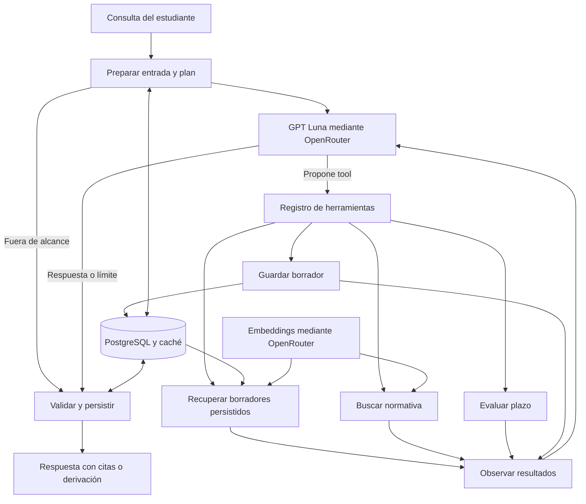

# Arquitectura con OpenRouter

Sólo `src/provider.py` se conecta a modelos. Chat y embeddings usan la misma API y comparten el tope monetario. No se ejecutan modelos en el equipo. Las búsquedas del manual y de borradores pueden solicitar embeddings remotos. LangGraph controla las transiciones. `ConversationBufferWindowMemory(k=5)` usa un adaptador PostgreSQL para conservar hasta 10 mensajes por conversación y borrar los anteriores. El agente es stateful; cada solicitud al modelo incluye explícitamente el contexto seleccionado.

La memoria de corto plazo elimina turnos antiguos. La de largo plazo recupera artefactos guardados mediante `recuperar_borradores`, sólo a petición, con vectores de OpenRouter y datos de la misma conversación. Consulta hasta veinte borradores, devuelve hasta dos y no atribuye a esos textos vigencia normativa. `src/long_term.py` aplica la similitud y el umbral.
